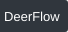
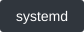
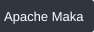

# Hi, I'm Totoro.

**DeerFlow committer.**

Working on agent runtimes and LLM inference systems.

### Selected open-source work

  &#8288;
  &#8288;
  &#8288;
  

### Selected projects

- **[Bridge](https://github.com/Totoro-qaq/dsh-plugin-bridge)** — Previewable session handoffs for DeepSeek Harness.
- **[Jot](https://github.com/Totoro-qaq/dsh-jot)** — Notes, checklists and documents beside DeepSeek Harness chats.
- **[Cobsidian](https://github.com/Totoro-qaq/Cobsidian)** — Agent-agnostic workflows for maintaining Obsidian knowledge bases.

[Icon credits](./assets/NOTICE.md)
